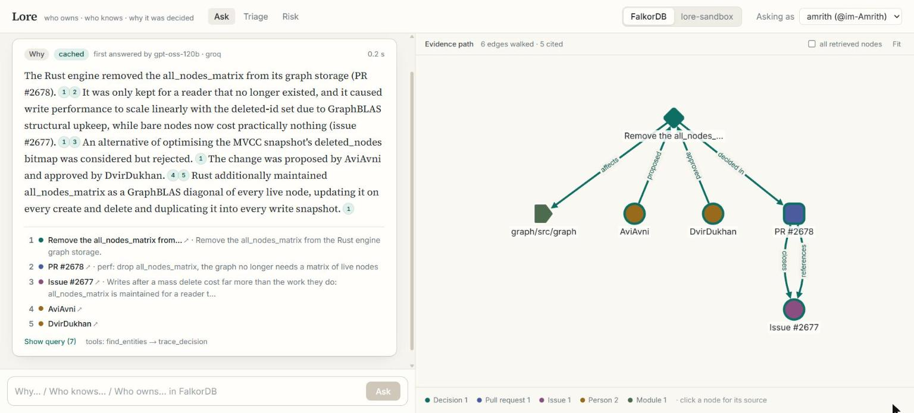
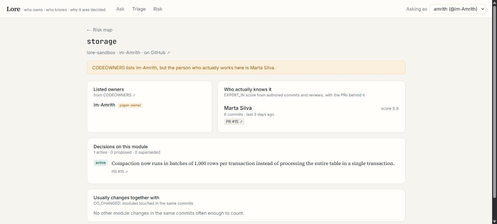
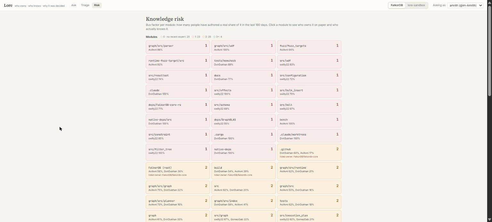
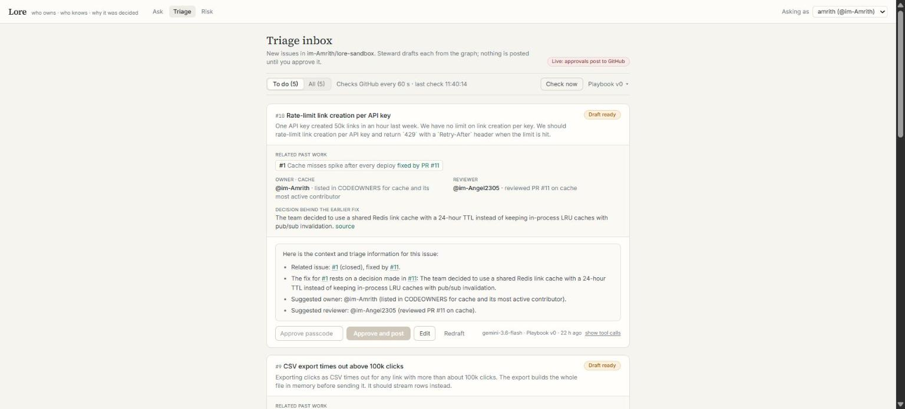
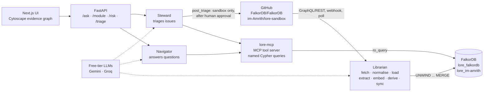
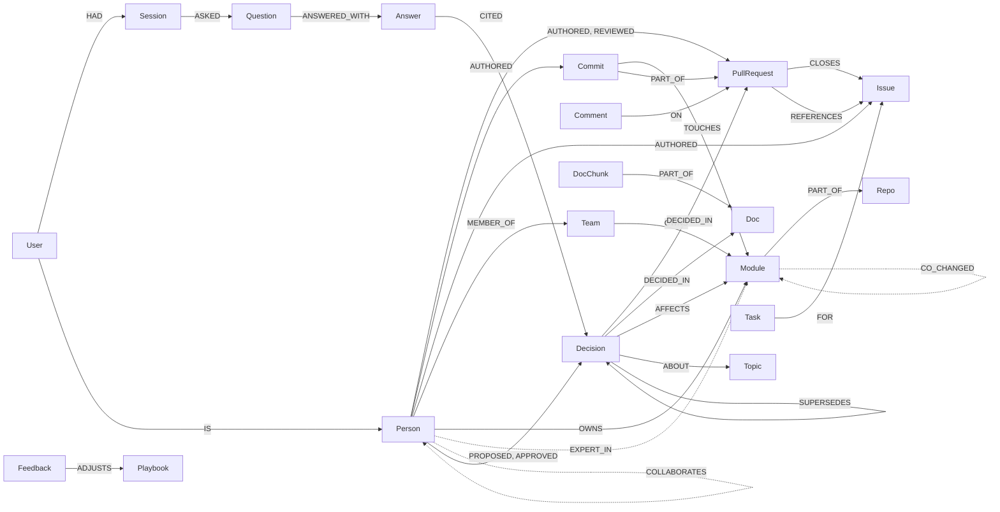

# Lore

**Ask why, get the path.**

Lore turns a public GitHub org's history into a company graph in FalkorDB, then answers "why was this decided", "who knows this" and "who owns this" with the exact path it walked through the graph and a link to the source for every claim. Its agents also triage new issues in a sandbox repo, and post only after a human approves.

| | |
| --- | --- |
| **Live app** | https://lore-kappa-mauve.vercel.app |
| **API** | https://13-237-159-217.sslip.io/docs (OpenAPI) |
| **Demo video** | _link coming_ |
| **Tracks entered** | Company Brain · Agents That Act on Connected Data · Agent Memory and Coordination |
| **Built for** | Graph Hacks (WeMakeDevs x FalkorDB), Oct 15-18, 2026 |

## What it does

| Feature | In one line |
| --- | --- |
| **F1 Why-trace** | Finds the decision behind a change and walks Decision → DECIDED_IN → PR → CLOSES → Issue, plus who proposed and approved it and what superseded it. |
| **F2 Who-knows** | Ranks people by EXPERT_IN, a time-decayed score from authored commits and reviews, and lists the PRs behind each score. |
| **F3 Ownership check** | Compares CODEOWNERS with real activity and flags "paper owners" who are listed but haven't touched the code. |
| **F4 Knowledge-risk map** | Bus factor per module, bridge people (betweenness) and working groups (label propagation). |
| **F5 Issue triage agent** | Steward drafts a triage comment for each new sandbox issue: related past issues, the decision behind the fix, owner and reviewer. A human approves before anything is posted. |

Plus memory ("what changed since I last asked?"), impact radius (CO_CHANGED) and decision supersession when a PR merges. Every answer has a "Show query" toggle with the Cypher that ran, and says "not found" with the nearest evidence instead of guessing.

**Ask: a why-question with its evidence path** (FalkorDB, "Why did the Rust engine drop all_nodes_matrix?")


**Module page: listed owner vs the person who actually knows the code** (lore-sandbox `storage`)


**Knowledge-risk map** (FalkorDB: 23 modules with bus factor 1, 29 with 2, 4 with 3+, 20 with no recent expert)


**Triage inbox: Steward's draft, waiting for approval**


## Why a graph

These questions are about relationships and paths, not about which text sounds similar. Vector search alone finds a paragraph that mentions the parser; it can't answer these:

- **Decision lineage.** "Why do we cache links in Redis, and is that still true?" means walking Decision → DECIDED_IN → PR → CLOSES → Issue, then following SUPERSEDES to see whether a later decision replaced it. The answer is a path, and Lore shows it.
- **Bus factor.** "Which parts depend on one person?" is an aggregate over EXPERT_IN edges per module with thresholds on share and recency (query 7). No document states it.
- **Impact radius.** "If we change the parser, what else usually changes?" is a walk over CO_CHANGED edges derived from commits, then the decisions that AFFECT those modules and who knows them.
- **Paper owners.** "Who owns storage?" means comparing the OWNS edge from CODEOWNERS with who actually authored and reviewed the code. The mismatch only exists between two kinds of edges.
- **Bridge people and working groups.** Betweenness and label propagation run on the COLLABORATES graph (author → reviewer); they're graph algorithms by definition.

In Lore, vector and full-text search only pick the starting node. Everything after that is Cypher or a FalkorDB graph algorithm.

## Architecture



- **Librarian** (`backend/lore/ingest/`) caches raw GitHub JSON, loads it in batches of 500, extracts decisions and topics with the fast LLM, embeds decisions, issues and doc chunks locally (`BAAI/bge-small-en-v1.5`, 384 dimensions), and derives EXPERT_IN, COLLABORATES and CO_CHANGED. On a merge it syncs just that PR and supersedes the decisions it replaces.
- **lore-mcp** (`backend/lore/mcp_server/`) is the only way agents reach the graph: ten tools, each running named queries from `queries/` and returning results, the nodes and edges touched, source links and the Cypher that ran.
- **Navigator** (`backend/lore/agents/navigator.py`) answers in at most 4 tool calls and usually 2 LLM calls (pick tools, write the answer); every sentence must cite a node id a tool returned, or it isn't shown.
- **Steward** (`backend/lore/agents/steward.py`) claims triage Tasks from the graph's work board, picks the facts in code and has the LLM write the comment. Approvals and edits feed a Playbook it follows next time.
- **API and UI**: FastAPI (`backend/lore/api/`) and Next.js 16 + Tailwind + Cytoscape.js (`frontend/`).

## Graph data model

One graph per org (`lore_falkordb`, `lore_im-amrith`) holding both company knowledge and agent memory. Ids are stable (`pr:<owner>/<repo>#<n>`, `person:<login>`, `module:<repo>:<path>`, `decision:<hash>`); timestamps are epoch seconds in `at` / `*_at`. Dashed edges are derived by Cypher jobs, not loaded from GitHub.



**Knowledge nodes** (counts in the live FalkorDB graph)

| Label | Key properties | Notes | FalkorDB graph |
| --- | --- | --- | --- |
| Person | `id`, `login`, `name` | Public GitHub identity only; commit-only authors get `person:name:<slug>`. No emails | 310 |
| Team | `id`, `name` | From CODEOWNERS `@org/team` | 1 |
| Repo | `id`, `name` | | 1 |
| Module | `id`, `path`, `repo` | A directory (or the repo root, `/`) | 135 |
| Commit | `id`, `sha`, `message`, `at` | `main` plus the `main-rs` history | 3,321 |
| PullRequest | `id`, `number`, `title`, `body`, `state`, `created_at`, `merged_at`, `url` | Full-text on title and body | 1,163 |
| Issue | `id`, `number`, `title`, `body`, `state`, `opened_at`, `closed_at`, `url`, `embedding` | Full-text + vector | 1,762 |
| Comment | `id`, `body`, `at`, `url` | The discussion layer | 15,498 |
| Doc | `id`, `path`, `title`, `url` | Design docs and ADRs | 6 |
| DocChunk | `id`, `text`, `embedding` | ~800-char overlapping pieces of a Doc; full-text + vector | 93 |
| Decision | `id`, `statement`, `rationale`, `alternatives`, `quote`, `status` (active / proposed / superseded), `kind`, `confidence`, `valid_from`, `valid_to`, `source_url`, `embedding` | Extracted by the LLM, always tied to a source and a verified quote; full-text + vector | 250 |
| Topic | `name` | Fixed list per org ([docs/TOPICS.md](docs/TOPICS.md)) | 30 |
| Release | `id`, `tag`, `at` | Loaded; SHIPPED_IN is not derived yet | 89 |

**Knowledge relationships**

| Relationship | From → To | Properties | FalkorDB graph |
| --- | --- | --- | --- |
| AUTHORED | Person → Commit, PullRequest, Issue, Comment, Doc | `at` | 21,749 |
| REVIEWED | Person → PullRequest | `state`, `at` | 5,076 |
| MEMBER_OF | Person → Team | | 0 (team membership isn't public) |
| OWNS | Person or Team → Module | `source: 'CODEOWNERS'` | 3 |
| PART_OF | Module → Repo; Commit → PullRequest; DocChunk → Doc | | 854 |
| TOUCHES | Commit → Module | `additions`, `deletions`, `at` | 4,920 |
| CLOSES | PullRequest → Issue | | 930 |
| REFERENCES | PullRequest, Issue, Comment, Doc → PullRequest, Issue, Commit, Doc | `at` | 7,310 |
| ON | Comment → PullRequest, Issue | | 15,498 |
| DECIDED_IN | Decision → PullRequest, Issue, Doc | | 250 |
| AFFECTS | Decision → Module | | 324 |
| ABOUT | Decision, PullRequest, Issue, Doc → Topic | | 1,225 |
| PROPOSED, APPROVED | Person → Decision | | 248, 241 |
| SUPERSEDES | Decision → Decision | `at`, `reason` | written by sync when a PR merges (sandbox demo) |
| EXPERT_IN *(derived)* | Person → Module | `score`, `authored`, `reviewed`, `commits`, `reviews`, `evidence`, `last_touch`, `last_authored` | 333 |
| CO_CHANGED *(derived)* | Module → Module | `count` | 251 |
| COLLABORATES *(derived)* | Person → Person (author → reviewer) | `weight` = distinct PRs | 59 |
| COLLABORATES_STRONG *(derived)* | Person → Person | `weight` >= 2; used only by label propagation | 32 |

**Memory and coordination nodes** (same graph, scoped by user)

| Label | Key properties | Linked by |
| --- | --- | --- |
| User | `id`, `github_login` | `(User)-[:IS]->(Person)` when the user is a contributor |
| Session | `id`, `started_at` | `(User)-[:HAD]->(Session)` |
| Question | `id`, `text`, `intent`, `at` | `(Session)-[:ASKED]->(Question)` |
| Answer | `id`, `text`, `cypher`, `at` | `(Question)-[:ANSWERED_WITH]->(Answer)-[:CITED {at}]->(any knowledge node)` |
| Task | `id`, `type`, `status` (open / claimed / drafted / approved), `claimed_by`, `draft`, `facts` | `(Task)-[:FOR]->(Issue)`: the work board between Librarian and Steward |
| Playbook | `name`, `steps`, `version` | Steward's procedural memory |
| Feedback | `text`, `rule`, `before`, `after`, `by`, `at` | `(Feedback)-[:ADJUSTS]->(Playbook)` |

**Indexes:** range indexes on every `id` plus `login`, `number`, `at`, `opened_at`, `merged_at`; full-text on PullRequest and Issue `title`/`body`, Decision `statement`/`rationale` and DocChunk `text`; vector indexes (cosine, 384 dimensions) on Issue, Decision and DocChunk `embedding`.

The full design, including what we planned but cut, is in [docs/PLAN.md](docs/PLAN.md#graph-data-model).

## Queries

Every Cypher query is a file in [`queries/`](queries/), loaded by name (no Cypher strings in Python), always parameterised, and read-only (`ro_query`) except loaders, derive jobs, memory writes, Task updates and sync.

**Graph algorithms and indexes used**

| What | Where | Used for |
| --- | --- | --- |
| `algo.pageRank` | `08_pagerank` | Most relied-on reviewers (derive report) |
| `algo.betweenness` (fixed sampling seed) | `08_betweenness` | F4 bridge people on the risk map |
| `algo.labelPropagation` | `08_label_propagation` | F4/F10 working groups on the risk map |
| `db.idx.vector.queryNodes` | `02_entry_decisions`, `02_entry_docs`, `02_entry_issues`, `09_similar_issues` | Starting node for a question; similar past issues for triage |
| `db.idx.fulltext.queryNodes` | `02_entry_decisions`, `02_entry_prs` | Exact terms in a question (fused with vector by reciprocal rank) |
| `vec.cosineDistance` | `03_trace_decision` | Ranking a decision's linked issues by closeness to the question |

**Every query file**

| File | What it does | Feature |
| --- | --- | --- |
| `00_healthcheck` | Create and return a test node | setup |
| `01_load_repos`, `01_load_modules`, `01_load_persons`, `01_load_teams`, `01_load_owns` | Repo, Module (PART_OF Repo), Person (no emails), Team and CODEOWNERS OWNS | load |
| `01_load_commits`, `01_load_touches`, `01_load_part_of`, `01_load_part_of_reset` | Commits with AUTHORED, TOUCHES per module with line counts, Commit PART_OF PR (reset before reload) | load |
| `01_load_prs`, `01_load_reviews`, `01_load_issues`, `01_load_closes`, `01_load_comments`, `01_load_references`, `01_load_releases` | PRs, reviews, issues, CLOSES, comments ON PRs/issues, REFERENCES parsed from text, releases | load |
| `01_load_docs`, `01_load_doc_chunks`, `01_load_doc_chunks_reset` | Docs and their ~800-char DocChunks | load, F1 |
| `01_load_topics`, `01_load_decisions`, `01_load_decisions_reset`, `01_load_affects`, `01_load_proposed`, `01_load_approved`, `01_load_about` | Extracted Decisions with DECIDED_IN, AFFECTS, PROPOSED, APPROVED, ABOUT | load, F1 |
| `01_load_indexes` | Range, full-text and vector indexes | all |
| `02_entry_decisions` | Starting Decision for a "why" question: vector + full-text, fused by weighted reciprocal rank | F1 |
| `02_entry_docs`, `02_entry_prs`, `02_entry_issues` | Fallback starting nodes: nearest doc chunks and issues (vector), PRs (full-text) | F1 |
| `02_entry_modules`, `02_entry_topics` | Module and Topic names mentioned in a question | F1-F4 |
| `03_trace_decision` | Lineage of a decision: sources, issues they close or reference, proposer and approver, affected modules, SUPERSEDES both ways, open PRs proposing a change | F1 |
| `04_expert_reset`, `04_expert_authored`, `04_expert_reviewed`, `04_expert_score` | Derive EXPERT_IN: authored commits with a 180-day half-life, reviews at half weight; skips bots and > 500-file commits | F2-F4 |
| `05_resolve_module` | A module named by id, path or last segment → Module id | F2-F4, F8 |
| `05_who_knows`, `05_who_knows_topic` | Top experts on a module (with evidence PRs) or a topic | F2 |
| `06_module_owners`, `06_paper_owners`, `06_team_owners` | CODEOWNERS owners vs active experts; owners with no touch in 12 months; team-owned modules | F3 |
| `07_bus_factor` | People per module with a real, recent share of authored work; single points of failure first | F4 |
| `08_collaborates_reset`, `08_collaborates`, `08_collaborates_strong` | Derive COLLABORATES (author → reviewer) and its repeat-collaborator copy | F4 |
| `08_pagerank`, `08_betweenness`, `08_label_propagation` | The three graph algorithms above | F4 |
| `09_similar_issues`, `09_issue_text`, `09_module_decisions` | Nearest past issues and where they were fixed; an issue's text; decisions on those modules | F5 |
| `10_co_changed_reset`, `10_co_changed`, `10_impact_radius` | Derive CO_CHANGED from commits touching 2-6 modules; co-changed modules with their decisions and experts | F8, module page |
| `11_remember`, `11_recall_questions`, `11_what_changed` | Write a question, answer and CITED edges; read a user's past questions; cited nodes something newer superseded or referenced | F6 memory |
| `13_issues_known`, `13_issue_upsert`, `13_open_issues`, `13_task_open` | Librarian intake of new sandbox issues and opening triage Tasks | F5 |
| `13_open_tasks`, `13_task_claim`, `13_task_draft`, `13_task_release`, `13_task_reopen` | Steward's side of the work board: atomic claim, draft, release, redraft | F5 coordination |
| `13_triage_inbox`, `13_task_approve` | The inbox, and a one-time approval recording whether the comment was posted | F5 |
| `13_playbook`, `13_feedback_add` | Procedural memory: an approved edit becomes Feedback that ADJUSTS the Playbook | F5 memory |
| `14_users_list`, `14_user_upsert` | Username picker; `(User)-[:IS]->(Person)` | memory |
| `15_pr_states`, `15_promote_decisions`, `15_sources_without_decisions`, `15_decisions_of_sources`, `15_modules_of_commits` | Sync a merged PR: is it loaded, proposed → active in place, what still needs extraction, which modules to re-derive | sync |
| `15_supersede_candidates`, `15_decision_detail`, `15_supersede` | Active decisions on the same module and topic as a new one; write SUPERSEDES, `status = 'superseded'`, `valid_to` | sync, F1 |
| `16_demo_questions`, `16_demo_forget`, `16_demo_empty_sessions`, `16_demo_delete_user`, `16_demo_tasks`, `16_demo_task_redrafted` | `scripts/demo_reset.py`: clear demo memory, delete test users, Tasks back to drafted | demo ops |
| `20_extract_pr_candidates`, `20_extract_issue_candidates`, `20_extract_doc_candidates`, `20_extract_repo_modules` | What the LLM reads for decision extraction (human text only, bots excluded) | extraction |
| `21_embed_*_texts`, `21_embed_docs`, `21_embed_set_*` | Text to embed per Decision, Issue and DocChunk; store `vecf32` embeddings | embeddings |
| `90_stats_nodes`, `90_stats_edges`, `91_check_authored_closes`, `92_check_evidence_prs` | Load counts, a load check, the eval's evidence check | checks |
| `93_data_version` | Fingerprint of an org's knowledge (memory excluded) that keys the answer cache | cache |

## Data

- **[FalkorDB/FalkorDB](https://github.com/FalkorDB/FalkorDB)**, including the `main-rs` branch history. The Rust engine became `main` through a single tree-replacing commit (PR #2279); without `main-rs` its author would look like the expert on every file, so Lore loads both and skips commits touching more than 500 files when deriving expertise. Commits since Apr 2025 and PRs back to Nov 2023: 3,321 commits, 1,163 PRs, 1,762 issues, 15,498 comments, 250 extracted decisions.
- **[im-Amrith/lore-sandbox](https://github.com/im-Amrith/lore-sandbox)**: a small **synthetic** repo ("Tern", a URL shortener) we built during the event for the demo moments real data can't promise: a decision reversed by a merge (PR #16), planted paper owners (storage, analytics) and a safe place for the agent to write. See [docs/SANDBOX_STORY.md](docs/SANDBOX_STORY.md).
- **Public data only.** Public GitHub data plus our own sandbox. No email addresses are stored (the snapshot script refuses to export a graph containing one), and nothing private, login-protected or paywalled is loaded.

## Eval

[`docs/golden_set.yaml`](docs/golden_set.yaml) holds 10 hand-checked questions on FalkorDB (q01-q10), plus three sandbox checks (s01-s03) and a not-found test (n01). `scripts/eval.py` runs each through the Navigator and scores it deterministically, with no LLM judge: every `must_cite` URL cited, every key fact present, every shown sentence cited.

**Run on the deployed server, 2026-10-18 06:04 UTC: golden q01-q10 7 of 10 pass; all checks 10 of 14.** Full answers: [docs/eval_results.md](docs/eval_results.md).

| id | type | question | result | why it failed |
| --- | --- | --- | --- | --- |
| q01 | why | Why did the Rust engine drop all_nodes_matrix? | PASS | |
| q02 | why | Why does the engine now fold MVCC deltas on every write? | PASS | |
| q03 | why | Why are there two branches, main and master? | PASS | |
| q04 | why | Why were graphblas.sh and redisearch.sh replaced with a native-deps crate? | FAIL | right decision and PR cited, but the answer leaves out two key facts (submodule, cache) |
| q05 | who | Who should I ask about indexes in the Rust engine? | PASS | |
| q06 | who | Who knows the Cypher parser? | FAIL | names the right experts but cites no evidence PR for AviAvni on graph/src/parser and doesn't name the module |
| q07 | owns | Who owns the build folder, and who actually works on it? | PASS | |
| q08 | owns | Who owns the query planner? | FAIL | correct facts, but CODEOWNERS was retrieved and not cited |
| q09 | risk | Which parts of the engine depend on a single person? | PASS | |
| q10 | impact | If we change the parser, what else usually has to change? | PASS | |
| s01 | why | Why do we cache links in Redis? (sandbox) | FAIL | cites PR #11 and the ADR but not issue #1, which was retrieved |
| s02 | owns | Who owns analytics? (sandbox) | PASS | |
| s03 | risk | Which modules depend on one person? (sandbox) | PASS | |
| n01 | not-found | Why was Bolt support removed? | PASS | says no reason was recorded and shows the nearest evidence |

All four failures retrieved the right nodes; the misses are in what the answer-writing LLM chose to cite or mention. This run, 6 of 14 came from the answer cache and 2 from the LLM cache (both free); the 6 fresh answers took 4.2 s and 2.2 calls to the free-tier pool on average.

## Setup

Requirements: Docker Desktop, [uv](https://docs.astral.sh/uv/), Node 20+. Commands are PowerShell from the repo root.

**Local, from the snapshot (no keys needed to browse).** The graphs and cached demo answers are attached to the [`v0.1-snapshot` release](https://github.com/im-Amrith/lore/releases/tag/v0.1-snapshot), so nothing is fetched from GitHub and no LLM runs:

```powershell
copy .env.example .env
docker compose up -d falkordb                                     # FalkorDB on 6379, browser on http://localhost:3000
cd backend; uv sync; cd ..
uv run --directory backend python scripts/restore.py              # downloads lore.rdb + cached answers, verifies SHA256, loads
uv run --directory backend uvicorn lore.api.app:app --port 8000   # API, docs at http://localhost:8000/docs
cd frontend; copy .env.example .env.local; npm install; npm run dev   # UI on http://localhost:3001
```

The demo questions, module pages, risk map and triage inbox work without keys. Asking new questions needs a free-tier key in `.env` (`LLM_FAST_*` for Gemini or `LLM_SMART_*` for Groq).

**Rebuilding the graphs from GitHub** (needs `GITHUB_TOKEN` and the LLM keys):

```powershell
uv run --directory backend python scripts/fetch.py --repo FalkorDB/FalkorDB      # GitHub -> data/raw (cached)
uv run --directory backend python scripts/load.py --repo FalkorDB/FalkorDB       # data/raw -> lore_falkordb
uv run --directory backend python scripts/extract.py --repo FalkorDB/FalkorDB --sample 30   # review a sample first, then --load
uv run --directory backend python scripts/embed.py --org FalkorDB
uv run --directory backend python scripts/derive.py --org FalkorDB --report --algo
uv run --directory backend python scripts/eval.py --all
```

Every script is listed with its options in [CLAUDE.md](CLAUDE.md#commands).

**Deployed:** one EC2 server (FalkorDB, backend and Caddy in Docker, seeded from the same snapshot) set up and updated by [`deploy/ec2-setup.sh`](deploy/ec2-setup.sh); the frontend is on Vercel. Steps are in [Deploy](#deploy) below.

## AI use

- **Claude Code** (Anthropic) wrote most of the code under our direction: we described each milestone, reviewed what it produced, ran it against the real graph and committed it. Per-milestone notes are below.
- **Claude** (chat) helped us plan before the event: the docs in `docs/` (plan, prompts, golden set, topics, sandbox story) were drafted with it and then edited by us. All code was written during the event.
- **Gemini and Groq** (free-tier keys only) power the product: Gemini extracts decisions and topics; a pool of Gemini and Groq models runs the Navigator, Steward and the supersession judge.

What we designed, verified and decided ourselves:

- **The graph model:** labels, relationships, stable ids, what is derived vs loaded, memory in the same graph.
- **The golden set:** 10 questions hand-checked against the FalkorDB repo, with the data caveats (the `main-rs` history, bots, logins vs author names) that shaped the loaders.
- **Thresholds:** bus factor (authored score >= 0.9, >= 10% share, last 180 days, tuned against q09 and s03), the 180-day expertise half-life, decision confidence >= 0.6, the 0.30 related-issue distance and 0.15 duplicate distance, each checked against measured values.
- **The sandbox story:** the Tern repo, its cast, the planted paper owners and the reversible Redis decision.
- **Safety rules:** GitHub writes only to the sandbox, only after human approval with a passcode; free-tier keys only; no emails stored.

<details>
<summary>Per-milestone notes</summary>

- M0 scaffold (repo layout, Docker Compose, config, FalkorDB client, query loader, healthcheck): written with Claude Code.
- M4 expertise (queries 04-07, `scripts/derive.py`, bus-factor tuning against the golden set): written with Claude Code.
- M7 algorithms (queries 08 and 10, COLLABORATES / CO_CHANGED derive jobs, co-change module cap checked against golden q10): written with Claude Code.
- M5 decisions (`backend/lore/llm/`, `ingest/extract.py`, extraction prompt, queries 01 decision loaders and 20): written with Claude Code. Decision extraction itself runs on Gemini (`LLM_FAST_MODEL`); every decision keeps a verified source quote and link.
- M8 lore-mcp (`backend/lore/mcp_server/`, `lore/safety.py`, queries 03, 02 entry_modules/topics, 05 resolve_module/who_knows_topic, 09 helpers and 11, tests per tool): written with Claude Code. Thresholds were checked against the loaded graphs (e.g. duplicate distance 0.15 from measured sandbox distances).
- M9 Navigator + eval (`agents/navigator.py`, `llm/agent.py`, `scripts/ask.py`, `scripts/eval.py`, eval fields for the sandbox and Bolt entries in `golden_set.yaml`): written with Claude Code. The Navigator itself runs on Gemini `gemini-3.8-flash` with Groq `gpt-oss-120b` as fallback; the eval scores its answers deterministically (no LLM judge).
- M11 Ask screen (`frontend/`, `POST /ask/stream`, node labels and pending flags in Navigator answers): written with Claude Code.
- M10 API (`backend/lore/api/`, queries 13 and 14, `ingest/tasks.py`, `scripts/tasks.py`, API tests): written with Claude Code.
- M15 Sync + supersession (`ingest/sync.py`, `scripts/sync.py`, queries 15 and the `$modules` / `$missing` scoping of 04, 10 and 21, query 93's merge counts, the pull_request webhook and poll check, the answer-rule for superseded decisions, `tests/test_sync.py`): written with Claude Code, tested on a copy of the sandbox graph in a separate test FalkorDB with a simulated merge. The supersession judgement runs on the free-tier agent pool; which decisions are compared is decided by the graph (same module and topic).
- M12-lite Module + Risk pages and M16 polish (`frontend/app/module`, `frontend/app/risk`, `components/States.tsx`, module links from answers, loading/empty/error states; the repo-root module lookup fix in `resolve_module`) and `scripts/demo_reset.py` with queries 16: written with Claude Code; the reset was run on copies of the live graphs before the real graphs.
- M14 Deploy (`Dockerfile`, `deploy/docker-compose.yml`, `deploy/Caddyfile`, `deploy/ec2-setup.sh`, `scripts/snapshot.py`, `scripts/restore.py`, the deploy docs): written with Claude Code, including the free-host comparison that led to EC2.
- M13 Steward (`agents/steward.py`, `ingest/live.py`, the work-board, intake and Playbook queries in 13, the work-board MCP tools, webhook, poll loop, approve with Feedback, real posting behind `DRY_RUN`, `scripts/steward.py`, the triage inbox screen, `tests/test_steward.py`): written with Claude Code. The related-issue distance (0.30) and reviewer threshold (0.1) were checked against the two demo issues on a copy of the sandbox graph. The drafts and the rules learned from edits are written by the free-tier agent pool; the owner, reviewer and related issues are picked by code from tool results.
- M6 embeddings (`ingest/embed.py`, `graph/search.py`, queries 02, 09 and 21, `scripts/embed.py`, `scripts/find.py`): written with Claude Code, including the fusion tuning against q01-q04 and s01 (measured ranks are in `queries/02_entry_decisions.cypher`). Embeddings run locally with fastembed (`BAAI/bge-small-en-v1.5`).

</details>

## Known limitations

- **Free-tier LLM quotas.** The agents use only free-tier Gemini and Groq keys. Under load an endpoint returns 429 or 503 and the pool moves to the next model; if all are cooling down, a new question gets a "try again in a minute" error. Cached demo answers are unaffected. Smaller fallback models also cite less thoroughly, which is behind most eval failures.
- **The sandbox is synthetic.** lore-sandbox was written for the demo, so its paper owners and the reversed Redis decision are planted. The FalkorDB graph is real, but only 3-4 people are active there, so most engine modules have a bus factor of 1 or 2. That's a real finding, not a bug.
- **Confidence scores cluster high.** 221 of the 250 extracted decisions on FalkorDB have confidence 1.0, so the 0.6 cut-off mostly filters out obvious non-decisions rather than ranking the rest. Every decision keeps a verified source quote and link for that reason.
- **Not built from the plan:** Discussions, SHIPPED_IN (releases are loaded but unlinked), the onboarding path (F7) and stale-knowledge alerts (F9). Team membership isn't public on FalkorDB, so team-owned modules show the team plus the active experts.

## How it works in detail

### Frontend

`frontend/` is Next.js 16 + Tailwind 4, with Cytoscape.js for the evidence graph. The Ask screen has the conversation on the left and, on the right, the answer's subgraph with the walked path (the edges touching a cited node) drawn in teal and the rest of what was retrieved dimmed. Every sentence carries numbered citations that open the GitHub page; hovering one lights its node. Each answer shows which model wrote it, a "cached" badge when it came from the answer cache, and a "Show query" toggle with every Cypher query, its parameters and row count. While the Navigator works, `POST /ask/stream` streams each tool call and LLM step, so the screen shows what is being looked up. "Not found" answers get their own state with the nearest evidence; claims that rest on an unmerged proposal get a "draft PR proposes changing this" callout.

The Module page (`/module/<repo>/<path>`, from `GET /module/{id}`) puts the CODEOWNERS owners next to the people who actually work there (EXPERT_IN, with the PRs behind each score), lists the decisions on the module as active / proposed / superseded, and the modules it usually changes with (CO_CHANGED). Module citations in answers and module nodes in the evidence graph link to it. The Risk page (`/risk`, from `GET /risk`) shows every module as a tile coloured by bus factor (0 grey "no recent expert", 1 red, 2 amber, 3+ green; the Navigator's `knowledge_risk` still gets only the first 30), with "single expert isn't the listed owner" first, then the bridge people (betweenness) and working groups (label propagation). Every screen has loading, empty and error states with a retry.

### API

`backend/lore/api/app.py` (FastAPI, OpenAPI docs at `/docs`), one route per screen:

| Route | Returns |
| --- | --- |
| `POST /ask` `{org, user, question}` | The Navigator's answer: cited sentences, citations with links, the subgraph and the walked path, every Cypher query that ran, the tools and LLM endpoints used. At most `ASK_PER_MINUTE` (5) and `ASK_PER_DAY` (100) per user; 429 with `Retry-After` past that, 503 when every free-tier LLM endpoint is out |
| `GET /module/{id}` | CODEOWNERS owners vs active experts (paper owners, mismatch), experts with evidence PRs, decisions on the module split into current / pending proposals / history, co-changed modules |
| `GET /risk` | Bus factor per module (single-expert first), bridge people (betweenness), working groups (label propagation) |
| `GET /triage`, `POST /triage/{task}/approve` | Triage Tasks with their issue, Steward's draft and the facts it was written from; approve first checks `APPROVE_PASSCODE` (403 when wrong, 429 after 5 wrong tries a minute from one IP), then mints the approval token for that issue and exact text, calls `post_triage` (sandbox only; posts for real only with `DRY_RUN=false`) and marks the Task approved. An edited draft is stored as Feedback and adds a rule to the Playbook |
| `POST /triage/{task}/redraft`, `POST /triage/sync`, `GET /playbook` | Draft a Task again (after the Playbook changed); check the sandbox for new issues now; the Playbook's steps and Feedback |
| `POST /webhook/github` | Sandbox `issues` events (opened, reopened, edited), verified with `X-Hub-Signature-256` and `GITHUB_WEBHOOK_SECRET`; the issue is loaded, gets a Task and Steward drafts it in the background. `pull_request` closed + merged: a sync of that PR (see Sync and supersession) |
| `GET /memory/{user}` | Past questions per org and what changed since in the nodes their answers cited |
| `GET /users`, `POST /users` | Username picker (no passwords); a GitHub login links `(User)-[:IS]->(Person)` |

`/ask`, Steward and approve go through lore-mcp (an in-process MCP session); the read-only screens call the same named-query tool functions. CORS allows `CORS_ORIGINS` (the frontend on port 3001).

### lore-mcp

`backend/lore/mcp_server/` exposes Lore's ten tools (plus `data_version`, a cache key the agents read but the LLM is never offered, and Steward's work board: `open_tasks`, `claim_task`, `save_draft`, `release_task`, `get_playbook`) over MCP (Python MCP SDK 2.x): `find_entities`, `trace_decision`, `find_experts`, `module_owners`, `knowledge_risk`, `related_work`, `impact_radius`, `recall`, `remember`, `post_triage`. Each takes `org` (graph `lore_<org>`), runs only named queries from `queries/` (read-only except `remember`), and returns `results`, the `nodes` and `edges` it touched, `sources` (node id -> GitHub URL) and the `cypher` that ran. Decisions are always split into `decisions` (active), `pending_proposals` (open or draft PRs, never presented as current) and `history` (superseded); decisions below confidence 0.6 never appear. `post_triage` only targets `SANDBOX_REPO` (checked in `lore/safety.py`) and needs an approval token, an HMAC of the issue id and exact draft signed with `TRIAGE_APPROVAL_SECRET`, which only the UI's approve action mints. With `DRY_RUN=true` (the default) it only prints the comment; with `DRY_RUN=false` it posts it with `GITHUB_TOKEN`.

### Navigator

`backend/lore/agents/navigator.py` answers a question through a real MCP client session with `lore-mcp` (stdio). It lists the server's tools and gives their schemas to the LLM, which comes from a pool of free-tier endpoints tried quality first (`AGENT_LLM_POOL`: gemini-3.8-flash, Groq gpt-oss-120b, gemini-3.6-flash, Groq gpt-oss-20b, gemini-3.5-flash-lite). A per-minute 429 cools an endpoint down for its retry-after and a daily quota marks it exhausted until its reset, so no endpoint is hammered; the state is shared across runs in `data/cache/llm/endpoint_state.json`. A question usually costs two LLM calls: call 1 picks every tool it needs at once (they run in parallel from the model's point of view), call 2 writes the answer; a third call happens only when every tool result came back empty. Answers are cached under the normalized question, the org, the graph's data version (the `data_version` tool, query 93, which changes after a load, sync or derive) and a hash of the prompts; `scripts/warm.py` pre-answers the demo questions. Tool results reach the LLM compacted (short field names, capped lists, no Cypher or embeddings; under ~4K tokens a call); the UI and eval get the full results. The loop: classify the intent (keyword rules, a hint only), always resolve names with `find_entities`, let the LLM pick up to three more tools (four calls per question in total), then a separate compose call with no tools and a strict JSON schema writes the answer as sentences, each citing node ids. Any cited id that no tool returned for this question is dropped, and a sentence left without a valid id is not shown. If nothing answers the question, the answer says "Not found" and shows the nearest evidence. `org` and `user_id` are filled in by code, never by the LLM, so a question can't read another org's graph or another user's memory. The answer, its citations, the subgraph, the path (edges touching a cited node) and every Cypher query that ran are returned, and the `remember` tool stores the question, answer and CITED edges (query 11 reads them back for "what changed since I last asked").

### Steward

`backend/lore/agents/steward.py` triages new issues in `SANDBOX_REPO` (F5). The agents hand off through the graph: the Librarian (`ingest/live.py`) loads a new issue, from the API's 60-second poll locally or the GitHub webhook when deployed, and opens a `Task {type: 'triage', status: 'open'}` for it. Steward claims it with the plan's atomic claim query, so two workers never draft the same issue. It then calls four lore-mcp tools: `related_work` (similar issues, the PRs that fixed them, their modules and decisions), `module_owners` on the main module (the fix's module, not `tests/`), `find_experts` with a low threshold for a reviewer, and `trace_decision` on the decision made in the earlier fix. Code, not the LLM, picks the facts:

- the related issues (the nearest, plus any within distance 0.30)
- the owner (the person who actually works there)
- a paper-owner warning when CODEOWNERS lists someone with no activity on the module
- the reviewer (the next person by expertise, else the CODEOWNERS owner)

The LLM pool then writes the comment from those facts, following the Playbook's steps. Links that no tool returned are stripped, and the draft and its facts are stored on the Task. Nothing is posted until a human approves in the triage inbox. If the human edits the draft first, the edit becomes a `Feedback` node that `ADJUSTS` the `Playbook`, and the rule it teaches is added to the Playbook's steps: the human's own words, or one LLM call that generalises the edit. The next draft follows it.

### Sync and supersession

`backend/lore/ingest/sync.py` keeps the sandbox graph current when a PR is merged (docs/PLAN.md "Keeping knowledge current"). The lore-sandbox webhook sends `pull_request` events; a merge (`closed` + `merged`) starts a sync in the background, and the API's 60-second poll also asks GitHub for recently merged PRs the graph still has unmerged, so a missed delivery is caught within a minute. A sync:

1. re-fetches just that PR (one GraphQL query), the commits added since the last fetch (`git fetch` and their logins) and the docs, into the raw cache, then normalises and `MERGE`s the repo (idempotent)
2. promotes the PR's decisions from `proposed` to `active` in place (same id, so answers and memory that cited the proposal still point at it)
3. extracts decisions only from changed PRs and docs that have none yet (in the demo: ADR 0003); a source that already has decisions is never re-extracted, since that would replace them and their history
4. embeds what changed, then for each newly active decision lists the active decisions on the same module and topic, and asks the LLM pool which ones it replaces; those get `(new)-[:SUPERSEDES {at, reason}]->(old)`, `status = 'superseded'` and `valid_to` = the merge
5. re-derives `EXPERT_IN` and `CO_CHANGED` only for the modules the new commits touched

Query 93 counts merged PRs and `SUPERSEDES` edges, so the data version changes and the Navigator's answer cache can't serve the pre-merge answer; its key also includes a hash of `queries/`. The demo merge (PR #16, in-process LRU) was tested on a copy of the sandbox graph in a separate FalkorDB, with `scripts/sync.py --simulate-merge` (the PR read from its head branch as if merged; nothing merged on GitHub): the PR #11 and ADR 0001 decisions both end up superseded by the PR #16 and ADR 0003 decisions, and "What changed since I last asked?" lists it.

## Deploy

The live demo runs on one AWS EC2 server (Ubuntu 24.04, t3.medium, Elastic IP `13.237.159.217`) and Vercel:

| Part | Where | URL |
| --- | --- | --- |
| Frontend (Next.js) | Vercel (project `lore`) | https://lore-kappa-mauve.vercel.app |
| Backend API + Steward | EC2, Docker | https://13-237-159-217.sslip.io (docs at `/docs`) |
| FalkorDB | EC2, Docker, same compose project | not exposed; only the backend reaches it |

Why not a free host: the backend holds the embedding model and lore-mcp in process (~1 GB with FalkorDB), more than the 512 MB free tiers; Hugging Face Docker Spaces need a paid plan; FalkorDB Cloud's free tier (100 MB, no persistence, deleted after 7 idle days) can't safely hold the ~90 MB FalkorDB graph. So FalkorDB runs next to the backend, loaded from a snapshot.

**The graphs come from a snapshot, not a rebuild.** `backend/scripts/snapshot.py` saves the local FalkorDB (after checking that no graph holds an email address) and packs the answer cache; the files are attached to the [`v0.1-snapshot` release](https://github.com/im-Amrith/lore/releases/tag/v0.1-snapshot) (`lore.rdb`, `answers.tar.gz`, `SHA256SUMS`), never committed. Deploying fetches nothing from the GitHub API for the graph and makes no LLM extraction calls.

### Backend on EC2

`deploy/docker-compose.yml` runs three containers with `restart: unless-stopped` (the Docker service is enabled at boot, so they come back after a reboot):

- `falkordb`: the pinned FalkorDB image, data in `/opt/lore/state/falkordb` (seeded once with `lore.rdb`; FalkorDB's own saves keep questions, Tasks and Feedback across restarts)
- `backend`: the root `Dockerfile` (Python 3.11, locked deps, the embedding model baked in), uvicorn on 8000, caches in `/opt/lore/state/cache`
- `caddy`: HTTPS on 80/443 with an automatic Let's Encrypt certificate for `<ip-with-dashes>.sslip.io` (sslip.io resolves that name to the IP, so no DNS setup); streams `/ask/stream` unbuffered

1. Security group: inbound 22, 80, 443.
2. Create the secrets file on the server by hand (never in git):

   ```bash
   sudo mkdir -p /opt/lore && sudo nano /opt/lore/.env && sudo chmod 600 /opt/lore/.env
   ```

   | Variable | Value |
   | --- | --- |
   | `LORE_DOMAIN` | `13-237-159-217.sslip.io` (Caddy's site address) |
   | `CORS_ORIGINS` | the Vercel URL: `https://lore-kappa-mauve.vercel.app` (comma-separate several) |
   | `DEMO_ORG` | `FalkorDB` |
   | `SANDBOX_REPO` | `im-Amrith/lore-sandbox` |
   | `GITHUB_TOKEN` | fine-grained token: public read, plus Issues read/write on lore-sandbox only (Steward's poll and the approved comment) |
   | `GITHUB_WEBHOOK_SECRET` | the secret set on the lore-sandbox webhook |
   | `TRIAGE_APPROVAL_SECRET` | any long random string (`python -c "import secrets; print(secrets.token_hex(32))"`) |
   | `LLM_FAST_BASE_URL`, `LLM_FAST_API_KEY`, `LLM_FAST_MODEL` | Gemini OpenAI-compatible endpoint, free-tier key |
   | `LLM_SMART_BASE_URL`, `LLM_SMART_API_KEY`, `LLM_SMART_MODEL` | Groq, free-tier key |
   | `APPROVE_PASSCODE` | typed in the triage inbox to approve; checked before the approval token is made (5 wrong tries a minute per IP) |
   | `DRY_RUN` | `true` until the demo; `false` posts approved triage comments to lore-sandbox |
   | `STEWARD_POLL_SECONDS` | `60` (the poll is the webhook's fallback) |
   | optional: `EMBEDDING_MODEL`, `EMBEDDING_DIM`, `LLM_DAILY_CALL_CAP`, `ASK_PER_MINUTE`, `ASK_PER_DAY` | defaults as in `.env.example` |

   `FALKORDB_HOST` and `FALKORDB_PORT` are set by the compose file.
3. Run the setup script over SSH (installs Docker, clones the repo to `/opt/lore`, downloads and verifies the snapshot, seeds FalkorDB, builds and starts everything, waits for HTTPS):

   ```powershell
   scp -i lore.pem deploy/ec2-setup.sh ubuntu@13.237.159.217:~
   ssh -i lore.pem ubuntu@13.237.159.217 "bash ec2-setup.sh"
   ```

   Run it again to deploy new code: it pulls `main`, rebuilds and keeps the graph's runtime state (`--reset-graph` reloads the snapshot).
4. Pre-warm the demo answers (cached answers from the release are hits; the rest cost a few free-tier calls):

   ```bash
   cd /opt/lore && sudo docker compose --env-file .env -f deploy/docker-compose.yml exec backend .venv/bin/python scripts/warm.py
   ```

Logs: `sudo docker compose --env-file /opt/lore/.env -f /opt/lore/deploy/docker-compose.yml logs -f backend`. After editing `.env`: the same command with `up -d` (recreates the backend with the new values).

### Frontend on Vercel

```powershell
cd frontend
vercel login
vercel deploy --prod --build-env NEXT_PUBLIC_API_URL=https://13-237-159-217.sslip.io --env NEXT_PUBLIC_API_URL=https://13-237-159-217.sslip.io
```

`NEXT_PUBLIC_API_URL` is read at build time. Put the Vercel URL in the server's `CORS_ORIGINS` and run `up -d` (step above).

### Webhook

The lore-sandbox webhook sends `issues` and `pull_request` events to `https://13-237-159-217.sslip.io/webhook/github` (content type JSON, secret = `GITHUB_WEBHOOK_SECRET`); the backend checks `X-Hub-Signature-256`. Created with:

```powershell
gh api repos/im-Amrith/lore-sandbox/hooks -f name=web -F active=true -f "events[]=issues" -f "events[]=pull_request" -f config[url]=https://13-237-159-217.sslip.io/webhook/github -f config[content_type]=json -f config[secret]=<GITHUB_WEBHOOK_SECRET>
```

The 60-second poll stays on as a fallback, so a missed delivery is still drafted within a minute.
