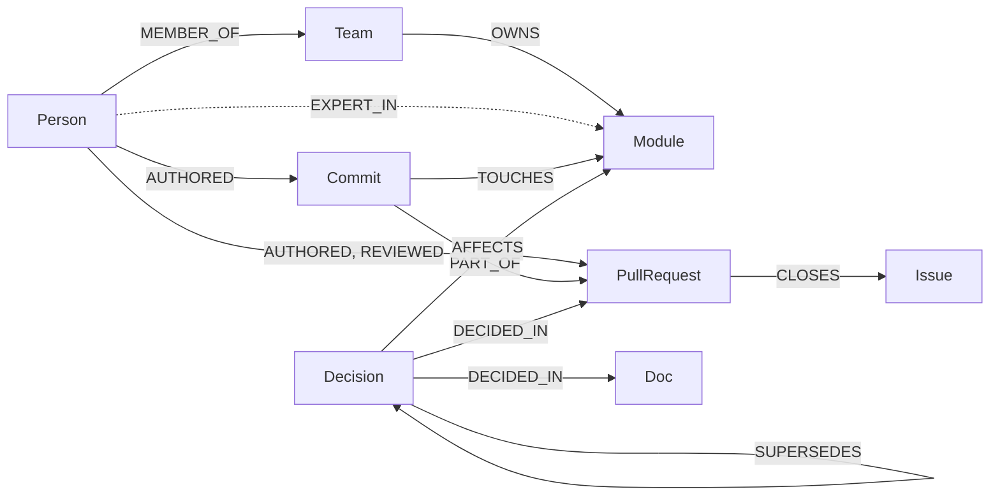
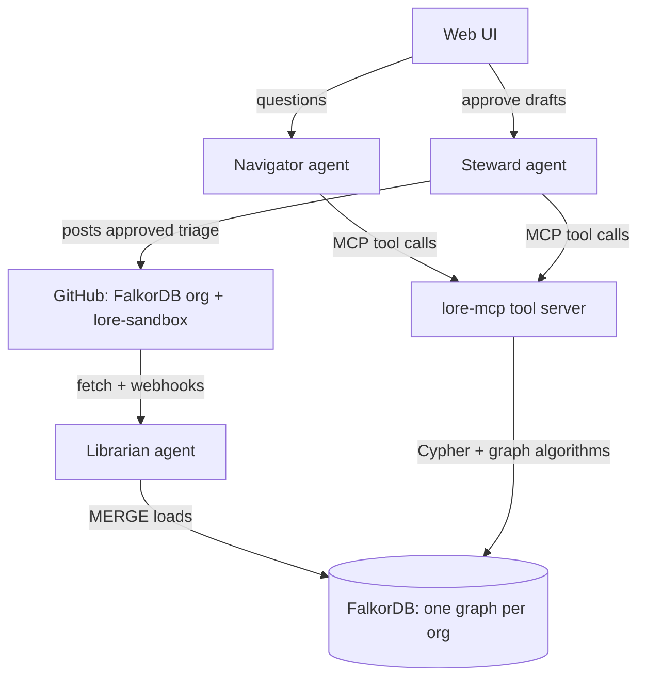

# Lore — Graph Hacks Track 3 Plan

Oct 6, 2026 · Amrithesh S Menon

> Source of truth for the project. Exported from the planning doc. Diagrams are redrawn here as Mermaid.

## Summary and strategy

Build **Lore**, an agent that turns a real open-source organisation's public GitHub history into a company graph in FalkorDB. It answers "who owns this", "who knows this" and "why was this decided" with the traced path and links, and it acts on new issues by routing them with sources.

- **Track:** Company Brain (Track 3) is the main fit. Also name Track 1 and Track 2 at submission: the rules allow one project in all three, and each track has its own single winner.
- **Event window:** online, Oct 15 12:01 AM IST to Oct 18 11:59 PM IST. Teams of 1 to 4.
- **Pitch line:** "Ask why, get the path."

**Rules that shape every design choice**

| Rule | What it means for Lore |
| --- | --- |
| FalkorDB must be primary and central; if the product works without it, the graph is decoration | Every feature is a traversal or a graph algorithm. Vector search only finds the starting node. |
| Only public, synthetic or your own data | Public GitHub data of an open-source org. Drop commit emails; keep public logins only. |
| Main coding starts Oct 15; notes, graph model sketches and diagrams are allowed before | This doc is the allowed prep. Write no project code until Oct 15. |
| AI coding assistants allowed if disclosed; you must explain the model, queries and architecture | Add an "AI use" section to the README. Every team member should be able to explain every query. |
| Submission: public repo, README with setup and graph model, the Cypher/algorithms used, demo video, live deployment (or full local setup), track names | Treat the README and demo as deliverables with their own time on Day 4. |

## The problem and the pitch

Every engineering org keeps asking three questions that document search cannot answer: who owns this, who actually knows it, and why is it built this way. The answer is a chain across commits, PRs, review threads, issues and docs, and the links in that chain are the answer.

A new contributor rebuilds that chain by hand, clicking through GitHub for an hour. A maintainer does the same for every incoming issue. Lore walks the chain in one query and shows the path as its explanation.

**Who it is for**

| User | Their question | What Lore gives back |
| --- | --- | --- |
| New contributor | "Why does this module work like this? Who do I ask?" | The decision, the PR and issue it came from, and the person to ping, with links |
| Maintainer | "Where does this new issue go?" | A drafted triage: related past work, likely duplicate, suggested owner and reviewer |
| Engineering lead | "Where are we one resignation away from losing knowledge?" | A knowledge-risk map of modules with a single active expert |

**Why an open-source org stands in for the company**

Track 3 asks for people, teams, projects, documents and decisions from docs, tickets and chats. A public GitHub org has all of them with real history: contributors are people, CODEOWNERS teams are teams, repos and directories are projects, docs and RFCs are documents, issues are tickets, and PR and issue threads are the chats. It is real, public and allowed, and it beats the synthetic "Acme Corp" Slack most teams will invent.

Use the [FalkorDB GitHub org](https://github.com/FalkorDB) as the demo company: the judges know its history and can check Lore's answers on the spot. Load one second org as a separate tenant to show isolation. Live chat platforms like Discord are login-protected, so they are out under the data rule; GitHub threads and Discussions cover the "chats" part.

## Data source and ingestion

Lore reads one GitHub org through the GitHub API, caches the raw JSON, and builds the graph in two passes: structural edges first (exact, cheap), then LLM-extracted decisions (fuzzy, cited).

**What gets pulled per repo**

| GitHub object | Becomes | Fields kept |
| --- | --- | --- |
| Contributors | Person | login, display name, first and last activity. No emails. |
| CODEOWNERS file | OWNS edges, Team | path pattern → owner login or team |
| Commits | Commit, TOUCHES edges | sha, message, date, changed paths, lines added and removed |
| Pull requests | PullRequest | title, body, state, merged date, author, reviewers, review states, "closes #N" links |
| Issues | Issue | title, body, labels, state, opened and closed dates |
| Issue, PR and review comments | Comment | body, author, date, parent |
| Discussions (if enabled) | Discussion | title, body, answer, comments |
| Markdown in docs/, design/, rfcs/, ADR folders, READMEs | Doc | path, title, last-changed date, text chunks |
| Releases | Release | tag, date, PRs included |

**Pipeline**

1. **Fetch** with the GitHub GraphQL API and a personal token; write raw JSON to `data/raw/<org>/` so the graph can be rebuilt without re-fetching. Cap the window at the last 18 months; check volume on Day 1 and widen if the graph is thin.
2. **Normalise** into entity records with stable ids (`pr:FalkorDB/FalkorDB#123`, `person:login`).
3. **Load structure** with batched `UNWIND … MERGE` queries: AUTHORED, REVIEWED, TOUCHES, CLOSES, PART_OF, OWNS.
4. **Link references** by regex over text: `#123`, commit SHAs, GitHub URLs, doc paths → REFERENCES edges.
5. **Map modules**: a file path becomes a Module at its first two directory levels, overridden by CODEOWNERS patterns where present.
6. **Extract decisions** with an LLM, only from merged PRs with real descriptions, closed issues with long threads, and docs/ADRs. Output per decision: statement, rationale, rejected alternatives, affected modules, people who proposed and approved, a source quote under 30 words, and a confidence score.
7. **Tag topics**: the LLM assigns 1–3 topics from a fixed list of ~30 per org (built on Day 1 from labels and directory names), so topics stay merged instead of drifting.
8. **Derive edges** with Cypher: EXPERT_IN (person → module, time-decayed), CO_CHANGED (module ↔ module), COLLABORATES (person ↔ person via shared reviews).
9. **Embed** decision statements, issue titles and doc chunks into vector indexes. Vectors only pick the starting node; the graph does the reasoning.

Later syncs repeat steps 1–9 only for items changed since the last sync timestamp (see "Memory, coordination and freshness").

## Graph data model

One FalkorDB graph per org (`lore_falkordb`, `lore_<second-org>`), holding both company knowledge and agent memory. Every edge carries an `at` timestamp, so any answer can be asked "as of" a date.

Core labels (dashed = derived by a Cypher job, not loaded from GitHub):



The tables below list every label and relationship, including Repo, Topic, Comment, Release and the memory nodes left out of the picture.

**Knowledge nodes**

| Label | Key properties | Notes |
| --- | --- | --- |
| Person | `login`, `name`, `first_seen`, `last_active` | Public GitHub identity only |
| Team | `name` | From CODEOWNERS `@org/team` entries |
| Repo | `name`, `description` |  |
| Module | `id`, `path`, `repo` | Directory or CODEOWNERS pattern |
| Commit | `sha`, `message`, `at` |  |
| PullRequest | `id`, `number`, `title`, `body`, `state`, `merged_at`, `url` |  |
| Issue | `id`, `number`, `title`, `body`, `state`, `labels`, `opened_at`, `closed_at`, `url`, `embedding` |  |
| Comment | `id`, `body`, `at`, `url` | The "chat" layer |
| Discussion | `id`, `title`, `url`, `answered` |  |
| Doc | `path`, `title`, `updated_at`, `url` | Chunks as `DocChunk` with `text`, `embedding` |
| Decision | `id`, `statement`, `rationale`, `alternatives`, `status` (active / superseded / reverted), `valid_from`, `valid_to`, `confidence`, `quote`, `embedding` | Extracted by the LLM, always tied to a source |
| Topic | `name` | Fixed list per org |
| Release | `tag`, `at` |  |

**Knowledge relationships**

| Relationship | From → To | Properties |
| --- | --- | --- |
| AUTHORED | Person → Commit, PullRequest, Issue, Comment, Doc | `at` |
| REVIEWED | Person → PullRequest | `state` (approved / changes requested / commented), `at` |
| MEMBER_OF | Person → Team |  |
| OWNS | Person or Team → Module | `source: 'CODEOWNERS'` |
| PART_OF | Module → Repo; Commit → PullRequest; DocChunk → Doc |  |
| TOUCHES | Commit → Module | `additions`, `deletions`, `at` |
| CLOSES | PullRequest → Issue |  |
| REFERENCES | PullRequest, Issue, Comment, Doc → PullRequest, Issue, Commit, Doc | `at` |
| ON | Comment → PullRequest, Issue, Discussion |  |
| DECIDED_IN | Decision → PullRequest, Issue, Discussion, Doc |  |
| AFFECTS | Decision → Module |  |
| SUPERSEDES | Decision → Decision | `at`, `reason` |
| PROPOSED, APPROVED | Person → Decision |  |
| ABOUT | Issue, PullRequest, Decision, Doc → Topic |  |
| SHIPPED_IN | PullRequest → Release |  |
| EXPERT_IN *(derived)* | Person → Module | `score`, `last_touch`, `evidence` |
| CO_CHANGED *(derived)* | Module → Module | `count` |
| COLLABORATES *(derived)* | Person → Person | `weight` (shared PRs and reviews) |

**Memory nodes** (same graph, scoped by user)

| Label | Key properties | Linked by |
| --- | --- | --- |
| User | `id`, `github_login` (optional) | `(User)-[:IS]->(Person)` when the user is a contributor |
| Session | `id`, `started_at` | `(User)-[:HAD]->(Session)` |
| Question | `text`, `intent`, `at` | `(Session)-[:ASKED]->(Question)` |
| Answer | `text`, `cypher`, `at` | `(Question)-[:ANSWERED_WITH]->(Answer)-[:CITED]->(any knowledge node)` |
| Playbook | `name`, `steps`, `version` | Procedural memory for the triage agent |
| Feedback | `text`, `at` | `(Feedback)-[:ADJUSTS]->(Playbook)` |
| Task | `type`, `status`, `claimed_by`, `at` | `(Task)-[:FOR]->(Issue)`; the shared work board between agents |

**Indexes**: range indexes on every `id`, `login`, `number` and `at`; full-text on Issue, PullRequest, Decision and DocChunk text; vector indexes on Issue, Decision and DocChunk `embedding`.

## Functionalities

Lore ships ten features; five are must-haves that make the demo, and the rest are cut in order if time runs short. Every one is a graph query or algorithm, so none survives removing FalkorDB.

| # | Feature | Example question or trigger | Graph work behind it | Tracks | Priority |
| --- | --- | --- | --- | --- | --- |
| F1 | **Why-trace** | "Why does the query planner cache plans?" | Vector/full-text finds the Decision or PR; then Decision → DECIDED_IN → PR → CLOSES → Issue, plus the SUPERSEDES chain and PROPOSED/APPROVED people | 3, 1 | Must |
| F2 | **Who-knows** | "Who should I ask about the Python client?" | EXPERT_IN scores (authored + reviewed, time-decayed), with the evidence PRs listed | 3 | Must |
| F3 | **Ownership check** | "Who owns `src/procedures`?" | CODEOWNERS OWNS compared with real activity; flags "paper owners" with no touch in 12 months | 3 | Must |
| F4 | **Knowledge-risk map** | Dashboard view | Per module: count of experts above a score threshold; betweenness on the COLLABORATES graph finds people whose departure cuts teams apart | 1, 3 | Must |
| F5 | **Issue triage agent** | A new issue opens in the sandbox repo | Related issues and decisions via shared modules and topics, duplicate candidates by vector + shared module, owner and reviewer from F2/F3; drafts a comment with links; posts only after a human approves | 1, 2 | Must |
| F6 | **Memory and "what changed"** | "What changed since I last asked about vector search?" | Walk the user's past Answers → CITED nodes → anything newer that SUPERSEDES or REFERENCES them | 2, 3 | Should |
| F7 | **Onboarding path** | "I want to contribute to the Rust client" | Ordered reading list: active decisions on the module, key docs, good-first issues, the expert to ping; skips what this user was already shown | 3, 2 | Should |
| F8 | **Impact radius** | "What else changes if we touch the parser?" | CO_CHANGED neighbours + decisions that AFFECT them + their owners | 1 | Could |
| F9 | **Stale-knowledge alerts** | Background job | Docs ABOUT a topic whose newest merged PR is 90+ days after the doc's last update; decisions with a newer conflicting decision | 3 | Could |
| F10 | **Team map** | Dashboard view | Label propagation on COLLABORATES finds the real working groups, shown beside the official CODEOWNERS teams | 3 | Could |

**What every answer includes**

- A short answer in plain words, where each claim links to the GitHub item it came from.
- An "evidence path" panel showing the exact nodes and edges walked, highlighted on the graph.
- A "show query" toggle with the Cypher that ran. Judges get to see the graph doing the work.
- A clear "not found" when no path exists, with the nearest evidence instead of a guess.

**F1 and F5 are the demo's spine.** F1 proves multi-hop reasoning with sources; F5 proves the agent acts, not just answers. Build both end to end before anything else.

## Agent architecture

Three agents share one graph and reach it only through named MCP tools; the graph is both their knowledge and their shared work board.



Agents never message each other directly: handoffs are Task nodes in the graph, so every step is stored and traceable.

**Agents**

| Agent | Job | Reads | Writes |
| --- | --- | --- | --- |
| Librarian (ingest) | Fetches GitHub, extracts decisions, refreshes derived edges, flags stale docs | GitHub API, the graph | Knowledge nodes and edges |
| Navigator (Q&A) | Answers user questions with traced paths | Knowledge + that user's memory | Question, Answer, CITED edges |
| Steward (triage) | Handles new issues: related work, duplicates, owner, draft comment | Knowledge, Playbook, Feedback | Task, draft, Feedback; posts to GitHub after approval |

**MCP tools (a small `lore-mcp` server in Python)**

Named tools beat letting the LLM write raw Cypher: they are fast, safe, and each maps to a feature judges can see. The official [FalkorDB MCP Server](https://github.com/FalkorDB/FalkorDB-MCPServer) can sit beside it as a read-only escape hatch for ad-hoc questions.

| Tool | Input | Returns |
| --- | --- | --- |
| `find_entities` | text, optional labels | Top nodes from full-text + vector search, with ids |
| `trace_decision` | node id | Decision lineage path: sources, issues, people, superseded versions |
| `find_experts` | module or topic, optional `since` | Ranked people with score and evidence PRs |
| `module_owners` | module | CODEOWNERS owners vs active experts, mismatch flag |
| `knowledge_risk` | repo | Modules with expert count, single-expert flags, bridge people |
| `related_work` | issue id or text | Similar issues, decisions on the same modules, duplicate candidates |
| `impact_radius` | module | Co-changed modules, affecting decisions, their owners |
| `recall` | user id, topic | Past questions, answers and what changed since |
| `remember` | user id, question, answer, cited ids | Writes memory nodes |
| `post_triage` | issue id, approved draft | Posts the comment to the sandbox repo (human-approved only) |

**Navigator's loop**

1. Classify intent: why, who-knows, owns, risk, impact, onboarding, or general.
2. Resolve the names in the question to node ids with `find_entities`.
3. Call the tool that fits the intent; the LLM picks it through MCP tool selection.
4. If the result is thin, expand once more with a second tool (cap: 4 tool calls per question).
5. Write the answer only from returned nodes; each sentence carries a node id that becomes a link.
6. Return the answer plus the subgraph (node and edge ids) for the evidence panel, and the Cypher used.
7. Call `remember` to store the question, answer and CITED edges.

**Guardrails**

- Answers are built only from tool results. If no path is found, Lore says so and shows the nearest evidence.
- Every query runs read-only except `remember`, `post_triage` and the Librarian's loaders.
- `post_triage` needs an explicit approve click, and only targets your own sandbox repo, never a real project.
- Use a cheap, fast model for extraction and a stronger tool-calling model for Navigator and Steward.

## Core Cypher queries and graph algorithms

These twelve queries are the product; the README must list them, and every team member should be able to explain each one. They are design sketches written before Oct 15: run each against FalkorDB on Day 1 and fix anything the engine rejects. Timestamps are epoch seconds; `$now` is passed in.

**1. Bulk load (pattern for every entity)**

```cypher
UNWIND $prs AS pr
MERGE (p:PullRequest {id: pr.id})
SET p.number = pr.number, p.title = pr.title, p.state = pr.state,
    p.merged_at = pr.merged_at, p.url = pr.url
MERGE (a:Person {login: pr.author})
MERGE (a)-[:AUTHORED {at: pr.created_at}]->(p)
```

**2. Entry point: find the starting node (vector, then full-text as fallback)**

```cypher
CALL db.idx.vector.queryNodes('Decision', 'embedding', 5, vecf32($q_vec))
YIELD node, score
RETURN node.id, node.statement, score
```

```cypher
CALL db.idx.fulltext.queryNodes('PullRequest', $q_text)
YIELD node, score
RETURN node.id, node.title, score LIMIT 5
```

**3. F1 Why-trace: decision lineage**

```cypher
MATCH (d:Decision {id: $decision_id})
OPTIONAL MATCH (d)-[:DECIDED_IN]->(src)
OPTIONAL MATCH (src)-[:CLOSES|REFERENCES]->(issue:Issue)
OPTIONAL MATCH (p:Person)-[r:PROPOSED|APPROVED]->(d)
OPTIONAL MATCH (d)-[:SUPERSEDES*1..5]->(older:Decision)
RETURN d,
       collect(DISTINCT src) AS sources,
       collect(DISTINCT issue) AS issues,
       collect(DISTINCT {login: p.login, role: type(r)}) AS people,
       collect(DISTINCT older) AS history
```

**4. Derive EXPERT_IN (authored commits, 180-day half-life)**

```cypher
MATCH (p:Person)-[:AUTHORED]->(:Commit)-[t:TOUCHES]->(m:Module)
WITH p, m,
     sum(exp(-0.693 * ($now - t.at) / 15552000.0)) AS s,
     max(t.at) AS last
MERGE (p)-[e:EXPERT_IN]->(m)
SET e.authored = s, e.last_touch = last
```

Run the same for reviews at half weight (`MATCH (p)-[r:REVIEWED]->(:PullRequest)<-[:PART_OF]-(:Commit)-[:TOUCHES]->(m)`, `WITH DISTINCT p, r, m` before the sum), then `SET e.score = coalesce(e.authored, 0) + coalesce(e.reviewed, 0)`.

**5. F2 Who-knows, with evidence**

```cypher
MATCH (p:Person)-[e:EXPERT_IN]->(m:Module {id: $module})
WHERE e.score > 0.5
OPTIONAL MATCH (p)-[:AUTHORED]->(pr:PullRequest)<-[:PART_OF]-(:Commit)-[:TOUCHES]->(m)
WITH p, e, collect(DISTINCT pr.url) AS prs
RETURN p.login, e.score, e.last_touch, prs[0..3] AS evidence
ORDER BY e.score DESC LIMIT 5
```

**6. F3 Paper owners (listed in CODEOWNERS, inactive 12 months)**

```cypher
MATCH (o:Person)-[:OWNS]->(m:Module)
OPTIONAL MATCH (o)-[e:EXPERT_IN]->(m)
WITH o, m, e
WHERE e IS NULL OR e.last_touch < $now - 31536000
RETURN m.path, o.login AS paper_owner
```

For team owners, expand first with `(t:Team)-[:OWNS]->(m), (o:Person)-[:MEMBER_OF]->(t)`.

**7. F4 Knowledge risk per module (bus factor)**

```cypher
MATCH (m:Module)
OPTIONAL MATCH (p:Person)-[e:EXPERT_IN]->(m)
WHERE e.score >= 1.0 AND e.last_touch > $now - 15552000
WITH m, collect(p.login) AS experts
RETURN m.path, size(experts) AS bus_factor, experts
ORDER BY bus_factor ASC
```

**8. Derive COLLABORATES, then rank people with algorithms**

```cypher
MATCH (a:Person)-[:AUTHORED]->(pr:PullRequest)<-[:REVIEWED]-(b:Person)
WHERE a <> b
WITH a, b, count(DISTINCT pr) AS w
MERGE (a)-[c:COLLABORATES]->(b)
SET c.weight = w
```

Most relied-on reviewers (PageRank: edges point from author to reviewer):

```cypher
CALL algo.pageRank('Person', 'COLLABORATES')
YIELD node, score
RETURN node.login, score ORDER BY score DESC LIMIT 10
```

Bridge people whose absence splits the contributor network (F4):

```cypher
CALL algo.betweenness({nodeLabels: ['Person'], relationshipTypes: ['COLLABORATES'],
                       samplingSize: 200, samplingSeed: 42})
YIELD node, score
RETURN node.login, score ORDER BY score DESC LIMIT 10
```

Real working groups for the team map (F10):

```cypher
CALL algo.labelPropagation({nodeLabels: ['Person'], relationshipTypes: ['COLLABORATES']})
YIELD node, communityId
RETURN communityId, collect(node.login) AS members, count(*) AS size
ORDER BY size DESC
```

**9. F5 Triage: similar past issues and where they were fixed**

```cypher
CALL db.idx.vector.queryNodes('Issue', 'embedding', 10, vecf32($issue_vec))
YIELD node, score
WITH node AS similar, score
WHERE similar.id <> $issue_id
OPTIONAL MATCH (similar)<-[:CLOSES]-(pr:PullRequest)<-[:PART_OF]-(:Commit)-[:TOUCHES]->(m:Module)
RETURN similar.number, similar.title, similar.state, score,
       collect(DISTINCT m.id) AS modules, collect(DISTINCT pr.url) AS fixes
```

The modules returned feed queries 5 and 6 for the suggested owner and reviewer. Check on Day 1 whether `score` is a distance or a similarity for your metric before ranking on it.

**10. F8 Impact radius (derive CO_CHANGED first)**

```cypher
MATCH (c:Commit)-[:TOUCHES]->(a:Module), (c)-[:TOUCHES]->(b:Module)
WHERE id(a) < id(b)
WITH a, b, count(c) AS n WHERE n >= 2
MERGE (a)-[r:CO_CHANGED]->(b)
SET r.count = n
```

```cypher
MATCH (m:Module {id: $module})-[c:CO_CHANGED]-(n:Module)
WHERE c.count >= 3
OPTIONAL MATCH (d:Decision {status: 'active'})-[:AFFECTS]->(n)
RETURN n.path, c.count, collect(DISTINCT d.statement) AS decisions
ORDER BY c.count DESC LIMIT 10
```

**11. F6 What changed since I last asked**

```cypher
MATCH (:User {id: $user})-[:HAD]->(:Session)-[:ASKED]->(q:Question)
      -[:ANSWERED_WITH]->(a:Answer)-[:CITED]->(k)
MATCH (newer)-[r:SUPERSEDES|REFERENCES]->(k)
WHERE r.at > a.at
RETURN q.text, k.id, newer.id, type(r), r.at
ORDER BY r.at DESC LIMIT 20
```

**12. F9 Stale docs**

```cypher
MATCH (doc:Doc)-[:ABOUT]->(:Topic)<-[:ABOUT]-(pr:PullRequest)
WHERE pr.merged_at IS NOT NULL
WITH doc, max(pr.merged_at) AS latest_change
WHERE latest_change > doc.updated_at + 7776000
RETURN doc.path, doc.updated_at, latest_change
```

Sources: [algorithms](https://docs.falkordb.com/algorithms/), [PageRank](https://docs.falkordb.com/algorithms/pagerank), [betweenness](https://docs.falkordb.com/algorithms/betweenness-centrality), [label propagation](https://docs.falkordb.com/algorithms/cdlp), [indexing](https://docs.falkordb.com/cypher/indexing), [Cypher cheat sheet](https://docs.falkordb.com/cypher/cheat-sheet).

## Memory, coordination and freshness

Memory lives in the same graph as the knowledge it refers to, so "what did I learn" and "what has changed since" are single traversals. Each org is its own FalkorDB graph, which gives tenant isolation for free.

**Three kinds of memory**

| Kind | What it stores | How Lore uses it |
| --- | --- | --- |
| Episodic | Sessions, questions, answers and the nodes each answer CITED | "What changed since I last asked" (query 11); onboarding skips what you've seen |
| Semantic | The knowledge graph itself, plus `(User)-[:IS]->(Person)` for contributors | Answers are personalised: "you reviewed the PR that introduced this" |
| Procedural | Playbook nodes for triage, adjusted by Feedback | When a maintainer edits a draft triage ("always tag the Rust client team for FFI bugs"), Steward stores it and follows it next time |

**Agents coordinate through the graph, not through chat**

- **Work board:** Librarian creates a `Task {type: 'triage', status: 'open'}` linked to each new issue. Steward claims it with one atomic query, so two Steward workers never take the same task:

```cypher
MATCH (t:Task {id: $task})
WHERE t.status = 'open'
SET t.status = 'claimed', t.claimed_by = $agent, t.claimed_at = $now
RETURN t
```

- **Handoffs carry node ids, not text:** when Steward needs a deeper "why" for an issue, it creates a Task for Navigator with the decision ids attached. Navigator's answer lands on the same Task, and Steward picks it up.
- **Concurrency:** keep writes small and batched with `UNWIND`; reads run read-only. Show it in the demo by running two Steward workers on a burst of 10 sandbox issues and showing no double claims.
- **Per-user memory:** every memory query starts from `(:User {id: $user})`, so users never see each other's history.

**Keeping knowledge current**

1. **Incremental sync:** a GitHub webhook on your sandbox repo, plus a poll every 15 minutes for the demo org using `since=<last sync>`. Only changed items are re-fetched and `MERGE`d.
2. **Local recompute:** after a sync, rebuild EXPERT_IN, CO_CHANGED and COLLABORATES only for the modules and people touched, not the whole graph.
3. **Time decay:** expertise halves every 180 days, so people who moved on fade out on their own.
4. **Supersession:** when a new decision AFFECTS the same module and topic as an active one, the LLM checks whether it replaces it. If yes: add `SUPERSEDES`, set the old one's `status = 'superseded'` and `valid_to`. Answers use active decisions by default and show the history.
5. **Stale flags:** query 12 runs after each sync; flagged docs show a warning in answers that cite them.
6. **Demo moment:** merge a PR in the sandbox repo that reverses an earlier decision, wait for the sync, then ask the same "why" question again and show the updated path.

## Tech stack and system architecture

Python for everything that touches the graph and the LLM, a React frontend for the graph views, and FalkorDB Cloud for the live demo so nothing heavy needs hosting.

| Layer | Choice | Why |
| --- | --- | --- |
| Graph database | FalkorDB in Docker locally; FalkorDB Cloud for the deployed demo | Required; Cloud removes database hosting work |
| Backend and agents | Python 3.11, FastAPI, the official `falkordb` Python client | Best-supported client, and the LLM libraries are Python-first |
| Agent tools | `lore-mcp` built with the Python MCP SDK; official FalkorDB MCP Server as a read-only extra | Named tools for features, raw Cypher only as a fallback |
| LLM | Any tool-calling model for Navigator and Steward; a cheaper model for extraction | Extraction is the bulk of LLM calls |
| Embeddings | One embedding model used everywhere, dimension matched to the vector indexes | Mixed models break similarity |
| GitHub access | GraphQL API with a personal token; webhook endpoint on FastAPI for the sandbox repo | GraphQL pulls PRs, reviews and comments in fewer calls |
| Scheduling | APScheduler inside the backend for the 15-minute sync | No extra service |
| Frontend | Next.js + Tailwind; Cytoscape.js or react-force-graph for the evidence path and maps | Path highlighting is the visual core of the demo |
| Hosting | Frontend on Vercel, backend on Render, Railway or Fly | Free tiers are enough for judging |

**Repos in the graph:** the FalkorDB org repos, plus a small sandbox repo you own (`lore-sandbox`) loaded into the same graph. The sandbox is where the demo opens issues, merges the decision-reversing PR, and receives triage comments, so Lore never posts to a real project.

**Added after review**

- **User identity:** a simple username picker in the UI (no passwords). The username becomes `User.id`; per-user memory needs it.
- **LLM cache and budget:** every LLM and embedding call is cached on disk, keyed by a hash of model + prompt + input. A daily spend cap is set by env var.
- **Demo snapshot:** after the graph is loaded and checked, save a snapshot (raw JSON + LLM cache, so a rebuild is free) so the demo never depends on the live GitHub API.
- **Public deployment guard:** rate-limit `/ask` per user and cap total LLM calls per day.
- **Pinned versions:** exact versions for the `falkordb` client, the MCP SDK and the LLM SDK.

## UI screens and demo script

Five screens, and the demo spends most of its time on the first and the fourth: a traced answer and an agent taking action.

**Screens**

| Screen | What is on it | Features |
| --- | --- | --- |
| Ask | Chat on the left; evidence-path graph on the right with the walked path lit up; source links under each answer; "show query" toggle | F1, F2, F3, F6, F7 |
| Module page | Paper owners vs real experts, decisions affecting the module with their status, co-changed modules | F2, F3, F8 |
| Knowledge-risk map | Modules as tiles coloured by bus factor (1 = red); a bridge-people list from betweenness; working groups from label propagation | F4, F10 |
| Triage inbox | New sandbox issues with Steward's draft: related issues, likely duplicate, suggested owner and reviewer, links; Edit, Approve and post buttons | F5 |
| My memory | Past questions; "changed since" badges on answers whose sources moved; stale-doc warnings | F6, F9 |

**Demo video (about 3 minutes)**

Before recording, pick real questions from FalkorDB's history whose answers you have checked by hand; the golden set from prep is the pool.

| Time | On screen | What it proves |
| --- | --- | --- |
| 0:00–0:20 | One line: a real "why" question and how long it took to answer by clicking through GitHub | The problem is real |
| 0:20–1:00 | Ask the why-question; the path lights up: decision → PR → issue → people; click a source | Multi-hop reasoning with sources (Track 3, Track 1) |
| 1:00–1:25 | "Who should I ask about X?" then the module page showing a paper owner vs the real expert | Who owns what vs who knows what (Track 3) |
| 1:25–1:50 | Knowledge-risk map; click a red module; show the betweenness list | Graph algorithms as agent tools (Track 1) |
| 1:50–2:25 | Open an issue in `lore-sandbox`; the draft triage appears in the inbox; approve; the comment shows on GitHub | The agent acts on what the graph shows (Track 1); agents hand off through shared state (Track 2) |
| 2:25–2:45 | New session: "what changed since I last asked?" after merging the decision-reversing PR | Memory across sessions; knowledge stays current (Track 2, Track 3) |
| 2:45–3:00 | Architecture diagram and the line "take FalkorDB out and nothing here works" | The graph is the product, not decoration |

## Build plan

Four days: data on Day 1, a working brain on Day 2, the product deployed on Day 3, and Day 4 for sync, polish and submission. Each day ends with a gate; if a gate fails, cut from the bottom of the feature table before moving on. Step-by-step prompts for each milestone are in `docs/PROMPTS.md`.

**Prep, Oct 6–14 (planning only, no project code)**

- [ ] Register on WeMakeDevs and add teammates; join the [FalkorDB Discord](https://discord.com/invite/Y2mMT9VdMy)
- [ ] Ask on Discord where the line is for pre-event scaffolding (generic templates vs project code)
- [ ] Read [Getting started](https://docs.falkordb.com/getting-started/), the [Cypher reference](https://docs.falkordb.com/cypher/) and [algorithms](https://docs.falkordb.com/algorithms/); watch the two FalkorDB videos on Cypher and algorithms
- [ ] Run FalkorDB and FalkorDB Browser in Docker on a toy graph to learn the tools
- [ ] Get a GitHub token, an LLM API key (with a spend limit) and a FalkorDB Cloud account
- [ ] Build the golden set in `docs/golden_set.yaml`: 10 real questions about FalkorDB's history, each with a hand-checked answer and links
- [ ] Sketch the five screens on paper or in Figma
- [ ] Draft the topic list and the module-mapping rules
- [ ] Agree roles (table below)

**Day 1, Oct 15: data foundation**

- [ ] Create the repo, README skeleton and docker-compose with FalkorDB
- [ ] Create `lore-sandbox` and seed it with about 10 issues and PRs, including one decision you will reverse later
- [ ] Fetch and cache raw GitHub JSON for the org and the sandbox
- [ ] Normalise and load structure; create all indexes
- [ ] Map modules and load CODEOWNERS
- [ ] Derive EXPERT_IN (query 4)
- [ ] **Gate:** queries 5 and 6 return believable people for three modules you know

**Day 2, Oct 16: the brain**

- [ ] LLM decision extraction and topic tagging; spot-check 20 decisions against their sources
- [ ] Embeddings and vector indexes
- [ ] Derive COLLABORATES and CO_CHANGED; run PageRank, betweenness and label propagation
- [ ] Build `lore-mcp` with the ten tools
- [ ] Navigator loop in a command-line script, writing memory
- [ ] **Gate:** at least 7 of 10 golden questions answered with the correct path

**Day 3, Oct 17: the product**

- [ ] FastAPI endpoints for each screen
- [ ] Ask screen with the evidence-path graph and "show query"
- [ ] Module page and knowledge-risk map
- [ ] Steward, the Task board, the webhook and `post_triage` to the sandbox
- [ ] Deploy: FalkorDB Cloud, backend, frontend
- [ ] **Gate:** the full demo flow works on the deployed URL

**Day 4, Oct 18: ship (deadline 11:59 PM IST; aim to submit by 8 PM)**

- [ ] Incremental sync and supersession; rehearse the decision-reversal moment
- [ ] My memory screen; error and empty states
- [ ] README: setup, graph model, the query list, architecture, AI-use disclosure
- [ ] Record the demo video
- [ ] Write the blog post
- [ ] **Gate:** submitted, naming all three tracks

**Team roles (team of four)**

| Role | Owns | Days 1–2 | Days 3–4 |
| --- | --- | --- | --- |
| Data | GitHub fetch, normalisation, decision extraction, sync | Ingestion and extraction | Incremental sync, supersession |
| Graph | Schema, indexes, every Cypher query, algorithms | Loaders, derived edges, algorithms | Query tuning, README query list |
| Agents | `lore-mcp`, Navigator, Steward, memory | Tools and Navigator loop | Steward, Task board, webhook |
| Product | Frontend, deployment, video, blog | Golden set, wireframes, UI shell | Screens, deploy, video, blog |

With fewer people, merge Data with Graph and Agents with Product. Solo: build F1–F5 only, and use one simple page instead of five screens.

## Submission checklist and blog post

The rules list six required items; the README matters most, because it is where judges see the graph model and the queries.

**Required by the rules**

- [ ] Public source-code repository
- [ ] README with setup instructions and the graph data model (the schema diagram and tables from this doc)
- [ ] The Cypher queries and graph algorithms the product depends on (the twelve above, in a `queries/` folder and listed in the README)
- [ ] Demo video of the working project
- [ ] Live deployment link, plus full local setup (`docker compose up` and a seed script) as backup
- [ ] Track names: Company Brain, Agents That Act on Connected Data, Agent Memory and Coordination

**Extra items that help judging**

- [ ] "AI use" section in the README naming the coding assistants used (required disclosure)
- [ ] Golden-set results: the 10 questions, Lore's answers, and which were right
- [ ] A "why a graph" paragraph: the three features that cannot be built with vector search alone (decision lineage, bus factor, impact radius)
- [ ] Screenshots of each screen in the README
- [ ] Data note: public GitHub data only, no emails stored

**Blog post (separate AirPods prize)**

Publish on Dev.to or Hashnode and link it in the submission. Outline:

1. The question that started it: one real "why" in FalkorDB's history and how long it took to answer by hand.
2. Turning a GitHub org into a company graph: the schema diagram.
3. Three queries that only a graph can answer, with the Cypher.
4. How the agents share memory and work through the graph.
5. What broke and what you would build next.

## Risks and scope cuts

The biggest risk is a thin or noisy graph, so Day 1's gate checks the data before any agent work starts.

| Risk | Effect | Mitigation |
| --- | --- | --- |
| Too little history in the chosen org | Answers look shallow | Check volume on Day 1; widen the time window or add a larger, active open-source org as a second tenant |
| Misleading history in FalkorDB/FalkorDB | Wrong experts: the Rust engine landed on `main` as one tree-replacing commit (PR #2279); its real history is on `main-rs` | Fetch `main-rs` too; skip bot authors and commits with 500+ files when deriving EXPERT_IN (see `golden_set.yaml` caveats) |
| Noisy decision extraction | Wrong "why" answers | Extract only from merged PRs with real descriptions, long issue threads and docs; store quote and confidence; hide decisions under 0.6 confidence; spot-check 20 |
| Agent invents things | Loses judges' trust | Answers built only from tool results; every sentence linked; a clear "not found" state |
| GitHub rate limits | Slow or broken ingestion | GraphQL, cached raw JSON, 18-month window, never re-fetch unchanged items |
| Cypher that FalkorDB rejects | Lost hours | Test every query against FalkorDB on Day 1; check the known-limitations page; ask on Discord |
| Judges see "just RAG" | Fails the "graph does real work" rule | Show paths and Cypher in the UI; lead the README with the three graph-only features |
| Posting to a real repo by mistake | Spams a real project | `post_triage` is hard-wired to `lore-sandbox` and needs an approve click |
| LLM bill runs away | Budget gone mid-event | Disk cache for every call, sample run before full extraction, daily spend cap, rate limit on the public site |
| Deployment breaks on the last day | No live link | Deploy on Day 3; keep `docker compose up` and the demo video as fallbacks |

**Cut order if time runs short** (first cut at the top)

1. F10 Team map
2. F9 Stale-knowledge alerts
3. F8 Impact radius
4. Second tenant org
5. Two parallel Steward workers (keep one)
6. F7 Onboarding path
7. My memory screen (keep "what changed" inside Ask)

Never cut F1–F5, the evidence-path view, or the "show query" toggle.

## Sources

- [Graph Hacks overview](https://www.wemakedevs.org/hackathons/falkordb) (challenge, tracks, prizes, why graphs, FalkorDB, FAQ)
- [Rules](https://www.wemakedevs.org/hackathons/falkordb/rules)
- [Schedule](https://www.wemakedevs.org/hackathons/falkordb/schedule)
- [Resources](https://www.wemakedevs.org/hackathons/falkordb/resources)
- [FalkorDB algorithms](https://docs.falkordb.com/algorithms/)
- [FalkorDB vector index](https://docs.falkordb.com/cypher/indexing/vector-index)
- [FalkorDB MCP Server](https://github.com/FalkorDB/FalkorDB-MCPServer)
