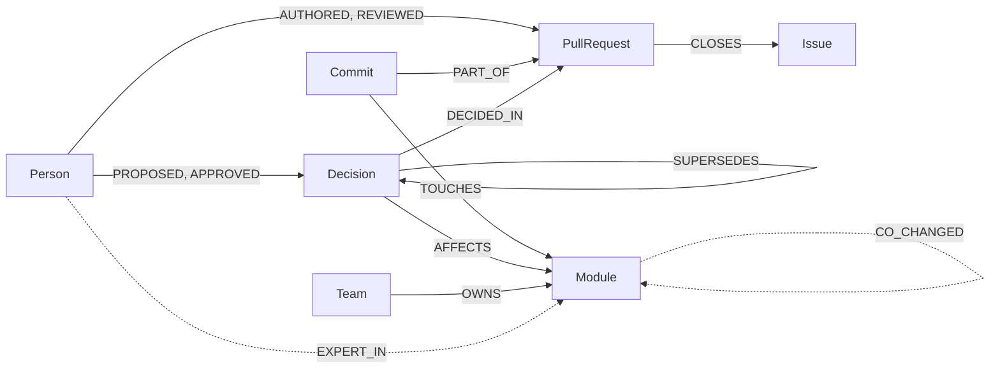

<!-- Published at https://dev.to/amrithesh_dev/ask-why-get-the-path-building-a-company-brain-on-falkordb-in-4-days-48if
Draft source for Dev.to. TODOs in HTML comments are details only I can fill in. Dev.to doesn't render
Mermaid: before publishing, swap the diagram for a screenshot of it from the GitHub README. -->

**Repo:** https://github.com/im-Amrith/lore · **Live app:** https://lore-kappa-mauve.vercel.app · **Demo video:** https://youtu.be/yq_YR116ClY

## A "why" that hides in plain sight

In September, FalkorDB's Rust engine dropped something called `all_nodes_matrix`. If you join the project today and wonder why, the answer exists, but it's scattered: PR #2678 has the benchmarks, issue #2677 has the symptom (writes after a mass delete got slow), the review thread says who signed off, and the commits say which part of the code it touched. Nothing links them except your patience.

<!-- TODO: how long it took me to trace this by hand, and how many tabs. -->

What I wanted was to ask "Why did the Rust engine drop all_nodes_matrix?" and get the answer *with the path it came from*: the decision, the PR it was decided in, the issue that PR closed, who proposed and approved it. Every claim linked. That's Lore, which I built for the WeMakeDevs x FalkorDB Graph Hacks in four days.


The answer: `all_nodes_matrix` was a GraphBLAS matrix of every live node, kept up to date on every create and delete, and nothing read it any more. Removing it made node creation flat after mass deletes and cut memory for a million bare nodes from 10.1 MB to 0.1 MB. AviAvni proposed it, DvirDukhan approved it.

## Turning a GitHub org into a graph

Lore loads a public GitHub org into one FalkorDB graph: people, PRs, issues, commits, comments, docs, and the modules (directories) that commits touch. An LLM pass then extracts **Decisions** from PRs, issues and ADRs, always tied to a source and a verified quote. A few edges are derived by Cypher jobs instead of loaded: `EXPERT_IN` (time-decayed authorship and reviews), `CO_CHANGED` (modules that change in the same commits) and `COLLABORATES` (author → reviewer).



For FalkorDB/FalkorDB that's 3,321 commits, 1,163 PRs, 1,762 issues, 15,498 comments and 250 extracted decisions.

**The main-rs surprise.** My first expertise numbers said DvirDukhan was the expert on *every file* in the Rust engine. The reason: the Rust engine became `main` on Aug 2 through **one commit** (PR #2279) that replaced the whole tree. Its real history, 2,917 commits, lives on the `main-rs` branch. So Lore loads both branches and skips any commit touching more than 500 files when deriving expertise. Graph data is only as good as the history behind it.

## Three questions only a graph answers

Vector search finds text that sounds like your question. These need relationships.

**1. Decision lineage.** The why-trace starts at a Decision (picked by vector + full-text search) and walks outward. Trimmed from `queries/03_trace_decision.cypher`:

```cypher
MATCH (d:Decision) WHERE d.id = $node_id
OPTIONAL MATCH (d)-[:DECIDED_IN]->(src)
OPTIONAL MATCH (src)-[:CLOSES|REFERENCES]->(issue:Issue)
OPTIONAL MATCH (p:Person)-[:PROPOSED|APPROVED]->(d)
OPTIONAL MATCH (d)-[:SUPERSEDES*1..5]->(older:Decision)
OPTIONAL MATCH (newer:Decision)-[:SUPERSEDES*1..5]->(d)
```

The real query also ranks the linked issues with `vec.cosineDistance` against the question, and finds open PRs that propose changing the decision (same module and topic), so a draft never gets presented as current.

**2. Bus factor and paper owners.** A person counts toward a module's bus factor if they authored a real share of it (≥ 10% of the module's authored score) recently (last 180 days). Reviews alone don't make you a maintainer. On FalkorDB's 76 modules: **23 have a bus factor of 1, 29 have 2, 4 have 3+, and 20 have no recent expert at all.** `graph/src/parser` is 96% AviAvni, `graph/src/udf` is 100%. That's not a bug in my scoring; only three or four people are active, and the graph says so.

The same query compares experts with CODEOWNERS (`OWNS` edges). In my sandbox repo, CODEOWNERS lists me for `storage`, but every commit there is Marta's. The mismatch only exists between two kinds of edges, which is exactly what a graph is for.


**3. Co-change impact.** "If we change the parser, what else usually changes?" `CO_CHANGED` is derived from commits that touch 2–6 modules:

```cypher
MATCH (c:Commit)-[:TOUCHES]->(m:Module)
WHERE NOT coalesce(c.bulk, false)
WITH c, collect(m) AS mods WHERE size(mods) >= 2 AND size(mods) <= $max_modules
UNWIND mods AS a UNWIND mods AS b
WITH a, b, count(c) AS n WHERE id(a) < id(b) AND n >= $min_count
MERGE (a)-[r:CO_CHANGED]->(b) SET r.count = n
```

Of the 45 parser commits that touched at most six modules, 26 (58%) also touched `graph/src/runtime` and 22 (49%) touched `graph/src/planner`. The impact query then adds the active decisions on those modules and who knows them.

Bridge people and working groups come from FalkorDB's built-in `algo.betweenness` and `algo.labelPropagation` on the `COLLABORATES` graph. No APOC, no GDS, just `CALL algo.*`.

## Agents on a graph

The agents never write Cypher. They reach the graph through **lore-mcp**, an MCP server with ten tools (`find_entities`, `trace_decision`, `find_experts`, `module_owners`, `knowledge_risk`, `related_work`, `impact_radius`, `recall`, `remember`, `post_triage`). Each one runs named, parameterised queries from `queries/` and returns the results, the nodes and edges it touched, and the Cypher that ran. That's what powers the "Show query" toggle on every answer.

- **Navigator** answers questions in at most four tool calls. Any sentence that doesn't cite a node a tool returned is dropped, and if nothing answers, it says "not found" and shows the nearest evidence.
- **Steward** triages new issues in my sandbox repo: similar past issues, the PR that fixed them, the decision behind that fix, an owner and a reviewer. It drafts a comment, and **nothing is posted until a human approves** it with a passcode.
- **Shared memory**: the Librarian and Steward coordinate through `Task` nodes with an atomic claim (`WHERE t.status = 'open' SET t.status = 'claimed'`). When I edit a draft before approving, the edit becomes `Feedback` that `ADJUSTS` a `Playbook`, and the next draft follows the new rule. Questions and answers live in the same graph, so "what changed since I last asked?" is a traversal from my old answers' `CITED` nodes.


## Knowledge that stays current

The sandbox has a decision with a twist: we cache links in Redis (PR #11, ADR 0001), and a draft PR #16 proposes going back to an in-process LRU. While #16 is open, Lore says "the current decision stands; a draft PR proposes changing it". When #16 merges, a webhook triggers a sync: re-fetch that PR, promote its decision from `proposed` to `active` in place, extract the new ADR, and ask the LLM whether the new decision replaces older ones on the same module and topic. Those get `SUPERSEDES` edges and `status = 'superseded'`. On the server, the merge reaches the updated answer in about **28 seconds**.

## An honest eval

Before writing any code, I wrote 10 golden questions from FalkorDB's history, each with the URLs a correct answer must cite and the facts it must mention. Scoring is deterministic: every expected URL cited, every key fact present, every sentence cited. No LLM judge.

**The first full run scored 7/10.** All the failures had retrieved the right nodes; the answer-writing model just left out a citation or a fact. Instead of loosening the golden set, I added deterministic grounding after generation: a why answer opens with the decision's statement verbatim, cited to its path; any sentence naming a person, module, PR or CODEOWNERS that the tools returned gets that citation; who/owns answers always name the module and its listed owner. **The final uncached run scored 10/10 golden (14/14 overall), with the golden set and scorer unchanged**, on the smaller fallback models, because the big ones had run out of free quota that day.

## What broke, and what's next

- **Memory.** The backend holds the embedding model and the MCP server in process, about 1 GB with FalkorDB, so free 512 MB hosts were out and I ended up on an EC2 t3.medium. <!-- TODO: the crashes I hit before resizing, and what I saw. -->
- **Free-tier quotas.** Every LLM call goes through a pool of free Gemini and Groq models that cools an endpoint down on a 429 and moves on. It works, but quality depends on which model is awake.
- **Fortinet TLS.** <!-- TODO: what the network's TLS inspection broke (model download? GitHub API?) and how I got around it. -->

Next: onboarding paths ("I want to contribute to the parser"), stale-doc alerts, and pointing Lore at a second real org.

*Built with Claude Code as my coding assistant; the graph model, golden set, thresholds and sandbox story are mine.*
